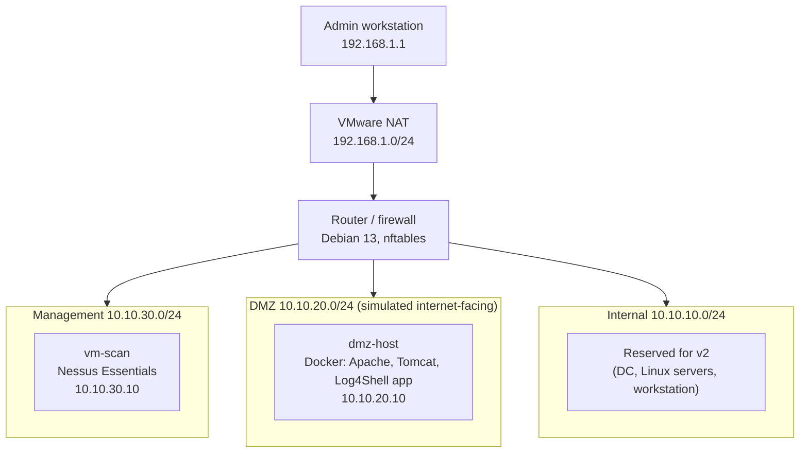

# Vulnerability Management Lab

A homelab vulnerability management program covering the full lifecycle: asset inventory, scanning, risk-based prioritisation, remediation, verification and reporting. Aligned to the ASD Essential Eight patching strategies and CIS Control 7.

> **Status:** v1 in progress. Network, firewall and scanner are built; scanning, triage and reporting are under way.

## Overview

Most scanner labs stop at "run a scan, export a PDF". This project treats vulnerability management as a process:

1. **Know what you have:** a documented asset inventory with owners, criticality and exposure
2. **Find vulnerabilities:** unauthenticated and authenticated scanning with Nessus
3. **Prioritise by risk, not just severity:** CVSS combined with exploitation data (CISA KEV, EPSS), asset criticality and network exposure
4. **Remediate and verify:** fixes are only closed after a re-scan confirms them
5. **Handle what can't be fixed:** documented, time-limited risk acceptance with compensating controls
6. **Report:** an executive summary and a technical findings report

## Architecture



| Segment          | Subnet         | Router IP    | Hosts (v1)      |
| ---------------- | -------------- | ------------ | --------------- |
| WAN (VMware NAT) | 192.168.1.0/24 | 192.168.1.10 | Router only     |
| Internal         | 10.10.10.0/24  | 10.10.10.1   | Reserved for v2 |
| DMZ              | 10.10.20.0/24  | 10.10.20.1   | dmz-host (.10)  |
| Management       | 10.10.30.0/24  | 10.10.30.1   | vm-scan (.10)   |

### Firewall policy

Default deny, stateful. Every rule is bound to an ingress interface to prevent source-address spoofing.

| From              | To         | Allowed                | Reason                                           |
| ----------------- | ---------- | ---------------------- | ------------------------------------------------ |
| Management        | Anywhere   | Yes                    | Scanning, administration, scanner plugin updates |
| Admin workstation | Management | Yes                    | Single admin entry point                         |
| Internal          | Log server | Log shipping port only | Telemetry to SIEM (v2)                           |
| Internal          | DMZ        | TCP 80, 443, 8080      | Access to published services                     |
| Internal          | Internet   | Yes (NAT)              | OS and application updates                       |
| DMZ               | Anywhere   | **No**                 | A compromised DMZ host cannot pivot or call out  |

The DMZ is blocked by two independent controls: no forward rule permits DMZ-initiated traffic, and no NAT rule translates DMZ addresses. Full ruleset: [`network/router-nftables.conf`](network/router-nftables.conf).

## What I built

- **Segmented network:** three isolated VMware networks behind a single Debian router with an nftables firewall
- **Scanner:** Nessus Essentials in a dedicated management segment, using least-privilege service accounts for authenticated scans
- **Targets:** deliberately vulnerable services in the DMZ:
  - Apache HTTP Server 2.4.49 (CVE-2021-41773, on CISA KEV)
  - Apache Tomcat with default manager credentials
  - Log4Shell-vulnerable application (CVE-2021-44228, on CISA KEV)
- **Program documentation:** rules of engagement, asset inventory, and remediation SLAs based on Essential Eight timeframes

## Findings summary

_To be completed after scanning and triage._

## Repository structure

```
.
├── docs/
│   ├── rules-of-engagement.md   # Scope, scan schedule, accounts, safety
│   ├── remediation-sla.md       # Risk tiers, deadlines, risk acceptance rules
│   └── troubleshooting.md       # Issues hit during the build and how they were fixed
├── inventory/
│   └── assets.csv               # Asset inventory with criticality and exposure
├── network/
│   ├── README.md                # IP plan, interface mapping, firewall design
│   ├── router-nftables.conf     # Firewall ruleset
│   └── router-interfaces        # Router interface configuration
├── reports/                     # Executive and technical reports (sanitised)
└── pipeline/                    # Automation (v2)
```

## Progress

- [x] Asset inventory and rules of engagement
- [x] Remediation SLA framework
- [x] Segmented network and firewall
- [x] Scanner deployed
- [ ] DMZ targets deployed and isolation verified
- [ ] Unauthenticated vs authenticated scan comparison
- [ ] Risk-based triage
- [ ] Remediation and verification re-scans
- [ ] Risk acceptance
- [ ] Executive summary and technical report

## What I learned

_To be completed._

## Roadmap (v2)

- Migrate the domain controller, Linux servers and log server into the segmented network
- Add a Windows workstation for authenticated Windows patch scanning
- Python pipeline: export scan results, normalise them, enrich with EPSS and KEV, and track finding state over time
- Feed findings into ELK for dashboards (finding age, MTTR, SLA breaches)
- Ansible playbooks for remediation
- Second scanner (OpenVAS/Greenbone) through the same pipeline

## Disclaimer

All vulnerable services run in an isolated lab with no inbound or outbound internet access. Do not deploy them on a network you do not control.
