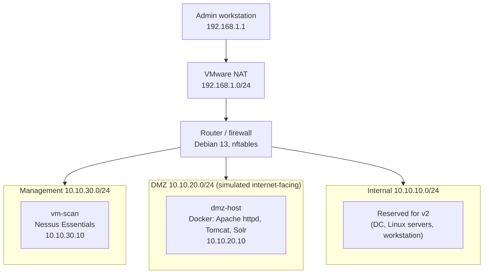

# Vulnerability Management Lab

A homelab vulnerability management program covering the full lifecycle: asset inventory, scanning, risk-based prioritisation, remediation, verification and reporting. Aligned to the ASD Essential Eight patching strategies and CIS Control 7.

> **Status:** v1 complete except reporting. Scanning, triage, remediation and verification done; executive and technical reports in progress.

## Overview

Most scanner labs stop at "run a scan, export a PDF". This project treats vulnerability management as a process:

1. **Know what you have:** a documented asset inventory with owners, criticality and exposure
2. **Find vulnerabilities:** unauthenticated and authenticated scanning with Nessus
3. **Prioritise by risk, not just severity:** CVSS combined with exploitation data (CISA KEV, EPSS), asset criticality, network exposure and manual validation
4. **Remediate under change control:** every fix linked to a change record
5. **Verify:** findings close only after a re-scan or manual test confirms the fix
6. **Handle what can't be fixed yet:** documented, time-limited risk acceptance with verified compensating controls
7. **Report:** an executive summary and a technical findings report

## Architecture



| Segment          | Subnet         | Router IP    | Hosts (v1)      |
| ---------------- | -------------- | ------------ | --------------- |
| WAN (VMware NAT) | 192.168.1.0/24 | 192.168.1.10 | Router only     |
| Internal         | 10.10.10.0/24  | 10.10.10.1   | Reserved for v2 |
| DMZ              | 10.10.20.0/24  | 10.10.20.1   | dmz-host (.10)  |
| Management       | 10.10.30.0/24  | 10.10.30.1   | vm-scan (.10)   |

### Firewall policy

Default deny, stateful. Every rule is bound to an ingress interface, backed by strict reverse-path filtering, to prevent source-address spoofing.

| From              | To         | Allowed                | Reason                                           |
| ----------------- | ---------- | ---------------------- | ------------------------------------------------ |
| Management        | Anywhere   | Yes                    | Scanning, administration, scanner plugin updates |
| Admin workstation | Management | Yes                    | Single admin entry point                         |
| Internal          | Log server | Log shipping port only | Telemetry to SIEM (v2)                           |
| Internal          | DMZ        | TCP 80, 443, 8080      | Access to published services                     |
| Internal          | Internet   | Yes (NAT)              | OS and application updates                       |
| DMZ               | Anywhere   | **No**                 | A compromised DMZ host cannot pivot or call out  |

The DMZ is blocked by two independent controls: no forward rule permits DMZ-initiated traffic, and no NAT rule translates DMZ addresses. Full ruleset: [`network/router-nftables.conf`](network/router-nftables.conf).

## Findings summary

The first authenticated scan of dmz-host returned **242 findings, 97 of them Critical or High**. Grouped by remediation action and validated manually, they reduced to **9 tracked items**.

| ID    | Finding                                       | Priority | Outcome                                                           |
| ----- | --------------------------------------------- | -------- | ----------------------------------------------------------------- |
| F-001 | Apache Solr 8.11.0: Log4Shell RCE (CISA KEV)  | P1       | Remediated, verified (authentication residual tracked)            |
| F-002 | Apache Tomcat 8.0.43 end-of-life              | P2       | Risk accepted (RA-001), 30 days                                   |
| F-003 | Apache httpd 2.4.49 path traversal (CISA KEV) | P1       | **Missed by scanner**, confirmed manually, remediated, verified   |
| F-004 | Java debug port (JDWP) exposed                | P1       | **Missed by scanner**, found by port review, remediated, verified |
| F-005 | 92 Ubuntu package vulnerabilities             | P2       | Remediated, verified                                              |
| F-006 | Log4j 1.x in dormant files                    | P4       | Remediated                                                        |
| F-007 | Router hardening (SSH, packages, ICMP)        | P3       | Remediated                                                        |
| F-008 | HTTP TRACE enabled (introduced by a fix)      | P3       | Remediated                                                        |
| F-009 | Tomcat manager and default apps exposed       | P3       | Remediated, verified                                              |

Full detail: [`reports/triage.csv`](reports/triage.csv).

**Notable points:**

- Two of the three P1s were **not detected by the scanner**: one suppressed by the scan policy, one an unrecognised service. Both were found through manual validation and open-port review.
- A KEV-listed Tomcat vulnerability (CVE-2017-12617) was verified as **not exploitable** in the current configuration (HTTP PUT disabled), which lowered its priority, with the evidence documented.
- One remediation (replacing Apache) **introduced a new finding** (TRACE enabled by default), caught by the verification scan.
- All three P1s **breached their 48-hour SLA**, which is reported rather than hidden.

## What I built

- **Segmented network:** three isolated VMware networks behind a single Debian router with an nftables firewall
- **Scanner:** Nessus Essentials in a dedicated management segment, with a least-privilege scan account (SSH key, password-protected sudo)
- **Targets:** deliberately vulnerable services in the DMZ (Apache httpd 2.4.49, Tomcat 8.0.43, Solr 8.11.0)
- **Program documentation:** rules of engagement, asset inventory, remediation SLAs, change records, risk acceptance register, troubleshooting log

## Repository structure

```
.
├── docs/
│   ├── rules-of-engagement.md   # Scope, scan schedule, accounts, safety
│   ├── remediation-sla.md       # Risk tiers, deadlines, risk acceptance rules
│   ├── risk-acceptance.md       # Risk acceptance register (RA-001)
│   ├── troubleshooting.md       # Issues hit during the build and how they were fixed
│   └── changes/                 # Change records (CHG-001 to CHG-003)
├── inventory/
│   └── assets.csv               # Asset inventory with criticality and exposure
├── network/
│   ├── README.md                # IP plan, interface mapping, firewall design
│   ├── router-nftables.conf     # Firewall ruleset
│   └── router-interfaces        # Router interface configuration
├── reports/
│   └── triage.csv               # Findings, priorities, remediation status
└── pipeline/                    # Automation (v2)
```

## Progress

- [x] Asset inventory and rules of engagement
- [x] Remediation SLA framework
- [x] Segmented network and firewall
- [x] Scanner deployed
- [x] DMZ targets deployed and isolation verified
- [x] Unauthenticated vs authenticated scan comparison
- [x] Risk-based triage
- [x] Remediation under change control and verification re-scans
- [x] Risk acceptance
- [ ] Executive summary and technical report

## What I learned

- **Severity is not risk.** 97 Critical/High findings collapsed to three P1s once exposure, exploitability and reachability were considered.
- **Scanners have blind spots.** Two of the three most serious issues were found by manual validation, not by the scanner.
- **KEV status is a starting point, not a verdict.** Checking whether the vulnerable configuration was actually present changed a P1 to a P2.
- **Fixes need verifying.** A remediation introduced a new finding, and an in-container fix would not have survived a container rebuild.
- **Fundamentals matter.** The hardest problem in the build was a layer 2 mapping error, solved with a packet capture rather than by changing configs.

## Limitations

- Nessus Essentials does not allow report export, so v1 triage was done manually from the scanner UI.
- Remediation of container services was done by replacing images; Tomcat was not upgraded and is under time-limited risk acceptance.

## Roadmap (v2)

- Upgrade Tomcat to a supported branch before RA-001 expires; enable Solr authentication
- Migrate the domain controller, Linux servers and log server into the segmented network
- Add a Windows workstation for authenticated Windows patch scanning
- Python pipeline using Greenbone/OpenVAS (open GMP API): export, normalise, enrich with EPSS and KEV, track finding state over time
- Feed findings into ELK for dashboards (finding age, MTTR, SLA breaches)
- Container image scanning (e.g. Trivy) alongside network scanning
- Ansible playbooks for remediation

## Disclaimer

All vulnerable services run in an isolated lab with no inbound or outbound internet access. Do not deploy them on a network you do not control.
